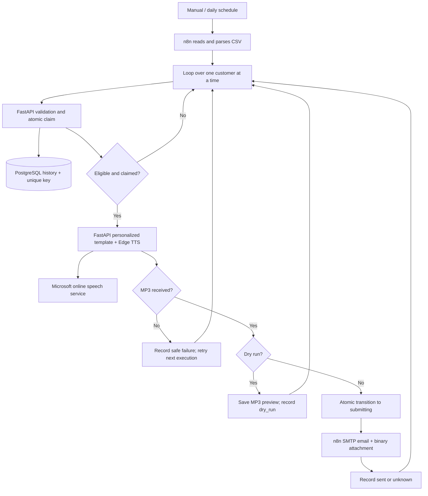

# Architecture and delivery semantics

This diagram describes email. WhatsApp has its own durable ledger and single-use reservation
flow; see [WhatsApp tracking, recovery and routing](whatsapp-reliability.md). Its customer-routing
path stays disabled by default. Speech generation is shared and unchanged.

Speech generation now runs through a common `SpeechProvider` interface. `TTS_PROVIDER=edge` retains
the current engine; the optional ElevenLabs adapter can be selected later with explicit backend
configuration. The same service renders templates and applies deadlines/concurrency before returning
MP3 to email or to the existing OGG/Opus converter. There is no automatic provider failover.
See [speech-provider details](speech-providers.md).

FastAPI's speech endpoint needs no n8n or database and is independently reusable. The same small deployment exposes a separate tracking module/API; this keeps validation, template rules, transactions, and retry eligibility in maintainable Python. n8n performs all orchestration, TTS retries, binary transport, SMTP submission, scheduling, and requests to record outcomes. Its only Code node restores previously generated binary data after the reservation HTTP call; it contains no business rules.

PostgreSQL is deliberately included. n8n Data Tables support workflow markers and light storage, but the documented row operations do not provide a user-defined unique reminder constraint combined with a transactional claim-and-state-change API. A get-then-insert workflow leaves a race between executions. We do not assume an upsert alone provides the required ownership/lease protocol. One PostgreSQL instance, two small tables, and short transactions solve this without brokers or a second database client in n8n. n8n retains its own default SQLite database in its persistent volume; the application never queries n8n internals.

Reminder identity is SHA-256 of tenant ID, normalized institution name, customer ID, due date, email channel, and mode (`dry_run`/`test_email`). One reminder per due-date cycle is supported. Renaming an institution changes identity; keep names stable. Template, voice and recipient changes do not bypass a successful send. Invalid records use a hash and retain no raw row. Events preserve skip reasons and state changes; history contains references and dates, not email addresses, phone numbers, names, bodies, tokens or audio.

Claim uses `INSERT ... ON CONFLICT DO NOTHING` followed by `SELECT ... FOR UPDATE` in one transaction. Only one caller receives a token. Every state update checks that token. Processing leases expire after 10 minutes; a new execution may reclaim them. A stale worker cannot reserve SMTP or acknowledge completion after expiration/reclaim. TTS failure retries have a 5-minute delay and at most 3 claims. The HTTP TTS node also makes at most 3 provider requests per claim, 5 seconds apart. `attempt_count` counts claims, not provider requests. n8n's schedule/re-execution coordinates retries; the API has no background scheduler.

| State | Meaning | Automatic reclaim |
|---|---|---|
| pending | Transient initial row inside claim transaction | Yes |
| processing | Owned preparation/TTS, lease active | Only after lease expiry |
| failed | TTS or preview failed before email reservation | After delay, within attempt limit |
| skipped | Invalid or ineligible input | Reevaluated on a fresh execution |
| dry_run | Preview written, no SMTP attempted | No, within dry-run identity |
| submitting | Permission consumed before calling SMTP | Never |
| sent | SMTP server accepted submission | Never |
| unknown | SMTP error/rejection/acknowledgement ambiguity | Never |

Exactly-once SMTP delivery cannot be guaranteed: PostgreSQL and an SMTP server do not share a transaction. A crash after reserving but before sending may lose a reminder; a crash after SMTP acceptance may leave `submitting`. The MVP favors avoiding duplicates: both states are quarantined. Even definite rejections use `unknown` conservatively because n8n exceptions do not provide a uniformly reliable acceptance classification. A repeated `submitting` transition is rejected; terminal acknowledgements may be safely retried. No automatic SMTP retry is enabled.

This protection assumes all delivery goes through the complete workflow and reservation gate. An operator manually rerunning a send node or editing history can bypass it. Recovery requires SMTP evidence and an audited decision; see deployment documentation. There is no claim of inbox delivery, recipient verification through an OTP, or confirmation that audio was heard.

The CSV adapter can be replaced with a CRM HTTP node that outputs the same JSON row contract. Keep the claim/TTS/delivery boundary. Future channels need their own provider adapters and channel-specific uniqueness. Consent, opt-out/suppression, per-recipient contact hours, multi-bank stable IDs, delivery webhooks, reporting and batch scaling are explicit future requirements. The manual/daily demo trigger is not a production contact-hours policy.

Sources: [Data Tables](https://docs.n8n.io/data/data-tables/), [pinned n8n node source](https://github.com/n8n-io/n8n/tree/n8n%402.43.6/packages/nodes-base/nodes).

## Optional webhook ingress (milestone 6)

The `webhook` Compose profile adds Cloudflare's temporary HTTPS tunnel and a
separate FastAPI gateway using the existing application image. Only Meta callback
and health routes are exposed. Signed incoming events and delivery receipts are
committed to additive PostgreSQL tables before acknowledgement. The private API
uses those timestamps when webhook window mode is enabled; n8n still orchestrates
outbound processing. Nothing automatically sends on an inbound event.
See [configuration and review guide](whatsapp-webhooks.md).
